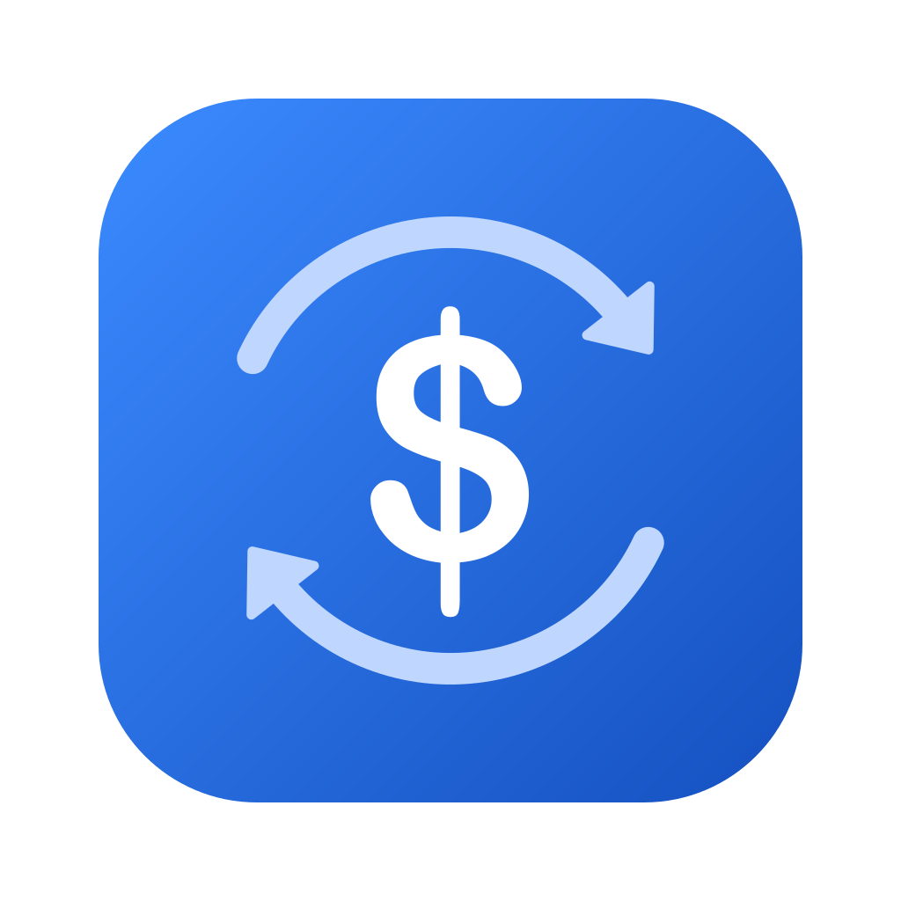

<p align="center">
  
</p>

<h1 align="center">Verter</h1>

<p align="center">
  A simple Colombian peso ⇄ US dollar converter for travelling in Colombia.<br />
  No sign-in, no ads, no convert button: type a price and see it in dollars.
</p>

<p align="center">
  <a href="https://github.com/SbsCruz/verter/releases/latest"><b>Download for Android</b></a>
</p>

> [!NOTE]
> **This is the first version of Verter, and it supports Colombian pesos (COP) only.**
> More countries and currencies are planned. Colombia comes first, so the core experience can be polished before the app expands.

---

## Features

- **Converts as you type.** The result updates on every keystroke.
- **Easy big numbers.** Pesos show dots as thousands separators (`45.000`), and dollars use commas and decimals (`1,250.50`).
- **Multiplier chips.** Type `25` and tap **×1k** to get `25.000`. Tap another chip to switch to **×100**, **×10k** or **×100k**, and it applies to the `25` you typed.
- **Swap direction.** ⇅ flips between COP → USD and USD → COP and carries the converted amount over. In dollar mode, the chips become **$10 $20 $50 $100**.
- **Works offline.** The last exchange rate is saved on your phone, and an offline badge shows how old it is. Pull down to refresh.
- **Light and dark mode.** Follows your phone's setting.
- **Keyboard-friendly.** The amount, the result and the chips stay above the keypad.

## Roadmap

- [x] **v1: Colombia.** COP ⇄ USD with live rates, offline support and quick multiplier chips.
- [ ] **More countries.** Add other local currencies, each with its own flag, number formatting and chips.
- [ ] **Currency picker.** Choose which country you're travelling in.

## Install (Android)

1. Open the [latest release](https://github.com/SbsCruz/verter/releases/latest) on your phone and download the `.apk` file.
2. When Android asks, allow your browser to **install unknown apps**.
3. If Google Play Protect warns that it doesn't recognize the app, tap **Install anyway**. It shows this warning for any app that doesn't come from the Play Store.

There's no iOS build for now. Distributing an iPhone app requires a paid Apple Developer account.

## Development

Built with [Expo](https://expo.dev) SDK 57, React Native and TypeScript.

```bash
npm install
npx expo start      # scan the QR code with Expo Go
```

| Command | What it does |
| --- | --- |
| `npx tsc --noEmit` | Type check |
| `npx expo lint` | Lint |
| `npx expo-doctor` | Check dependencies and config |

### Project structure

```
App.tsx              loads fonts and renders the screen
src/
├── screens/         ConverterScreen: layout and pull-to-refresh
├── components/      AmountInput, ActionButtons, ResultCard, QuickChips, RateFooter, …
├── hooks/           useConverter (amount, chips, swap) and useRate (fetch + offline cache)
├── theme/           colors, fonts, shadows, and the createStyles/useStyles helpers
├── icons/           SVG icons, one per file
├── constants/       currencies, input limits, chips
└── utils/           number formatting, dates, font fitting
```

Imports use the `@/` alias for `src/` (e.g. `import { useStyles } from '@/theme'`).

### Building the APK

The APK is built in the cloud with [EAS Build](https://docs.expo.dev/build/introduction/), which needs a free Expo account:

```bash
npx eas-cli@latest login
npx eas-cli@latest build -p android --profile preview
```

## Credits

- Exchange rates by [ExchangeRate-API](https://www.exchangerate-api.com).
- Font: [Manrope](https://fonts.google.com/specimen/Manrope).

## License

[MIT](LICENSE)
